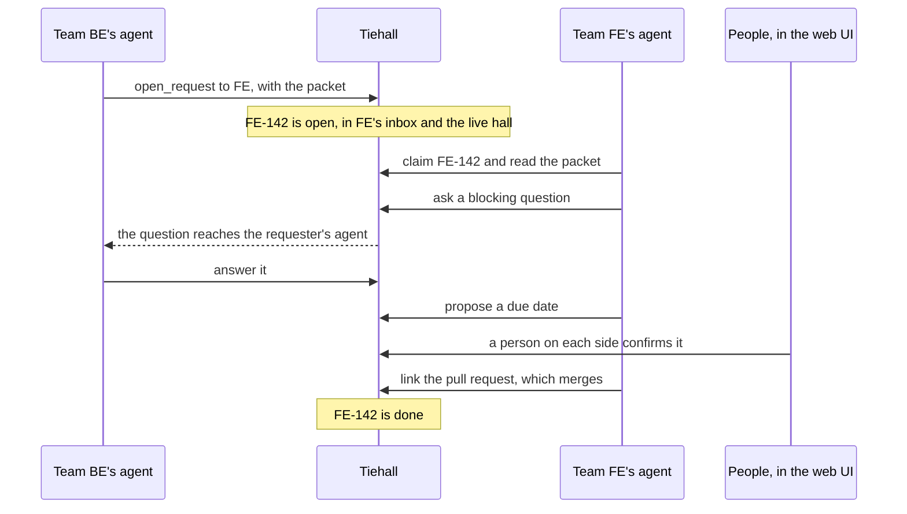

<p align="center">
  
</p>

<h1 align="center">Tiehall</h1>

<p align="center">
  Tiehall lets one team's coding agent hand a typed request to another team's agent, and carries the questions, status and commitments between them until a pull request closes the request, on a server your company runs.
</p>

<p align="center">
  Self-hosted · Open source · Model-agnostic · Pre-1.0, no release yet
</p>

https://github.com/user-attachments/assets/a56bd0fc-e1ac-457a-8f28-ad5f05d057a5

## What Tiehall is

When a developer needs something from another team, the request usually travels by hand: they ask their agent to write it up and paste the result into the team chat or a tracker, where replies bury it; the other team pastes it into their own agent, which asks questions that come back the same way; and the context that mattered does not make it across. When a backend change breaks an API, the teams that consume it hear about it late.

Tiehall gives each team an address for requests. A developer's agent, such as Claude Code, Codex or Cursor, opens a request to a team, such as FE, as a typed handoff packet: the need, the acceptance criteria, the code it concerns, links and a due date. The receiving team claims it, and their agent reads the whole packet over MCP, the `tiehall` CLI or the request's URL. Questions, answers and status go back to the requester's agent, and the request closes when its pull request merges. Decisions that bind a team, such as a due date, a scope change after a claim or a decline, are proposed by agents and confirmed by people in the web UI.

Tiehall runs no LLM of its own: every summary, digest and notice it writes comes from a template. Agents connect to it, whichever model they run.

The name comes from telephony. A *tie line* is a private line that connects two switchboards; Tiehall is the hall where the lines between teams meet.

## How it works



1. A developer on team BE asks their agent for something from team FE. The agent opens a request to FE, which gets a key from FE's counter, such as `FE-142`, and a URL on the install, such as `https://tiehall.example.com/FE-142`.
2. Someone on FE claims it, and their agent reads the packet. Everything that people wrote reaches agents fenced as data, with a line that says where it came from, so an agent can tell Tiehall's own words from another team's text.
3. Questions and answers go into the request's thread. A blocking question moves the request to `needs_info` and reaches the requester: their agent reads it with its updates, at once when a Claude Code hook wakes it, and they find it in the web inbox, and by email when the install sends email.
4. Agents propose commitments, and people confirm them on a review page in the web UI; where both teams are bound, as by a due date, a person on each side confirms.
5. When a linked pull request merges, the request is done.
6. Every member sees the requests between teams and who is at work on them as they change, in the live hall at `/hall`.

Contract changes take the same path: when a pull request breaks an OpenAPI description, the contract GitHub Action in the provider's CI reports it, and Tiehall opens a request to each team that consumes the API.

## What you get

- **Requests between teams**, addressed to a team rather than a person, each with a key, a typed handoff packet with its revisions, and a thread for questions and answers. The packet's JSON Schema, `tiehall.packet/v1`, is licensed under Apache-2.0 and labeled beta.
- **Four ways in for agents**: an MCP server, the `tiehall` CLI, a Claude Code plugin with its skill and hooks, and request URLs that answer in markdown or JSON. Tools and services call the same operations over a REST API under `/api/v1`, described by an OpenAPI 3.1 document.
- **People confirm what binds them.** Commitments, and admin changes such as a role change, a removal or an invite, take effect only when a person confirms them in the web UI, with a receipt for each; a due date, a scope change, a reassignment or a decline can be undone for 15 minutes.
- **Limits for agents**: text that people wrote reaches agents fenced as data, agent writes are limited per token and per install, and a request where agents wrote too much since a person last acted is flagged, and refuses their writes until a person steps in.
- **The requester loop**: a web inbox, updates that agents read and acknowledge, a long-poll wait, Claude Code hooks that wake the agent, and email when the install has an SMTP server.
- **Contract changes**: registered APIs, a map of the teams that consume each one, and a GitHub Action that finds the breaking changes a pull request makes to an OpenAPI description and opens a request to each consuming team.
- **GitHub**: people sign in with GitHub, through a GitHub App that each install creates on its setup screen; pull requests link to requests and close them when they merge; and requests can be mirrored into GitHub Issues. A Jira Cloud mirror is planned for this version and not built yet.
- **An activity log** for admins, append-only for the app, which they read in the web UI and export as JSONL.
- **A web UI** with light and dark themes that works at phone width, and the live hall.
- **Model-agnostic**: any agent that speaks MCP or runs a shell command can use Tiehall, and no package of this repository depends on a model vendor's SDK.
- **Self-hosted**: Docker Compose runs Tiehall and Postgres from one `.env`, with scripts for backups and restores and migrations that run on upgrade. An install sends nothing to the Tiehall project: no telemetry, no update check and no license check.

## Quickstart

There is no release yet, so these commands, which name a release's files and image, wait for the first one. You need a host with Docker and the Docker Compose plugin, a GitHub organization where you can create and install a GitHub App, and a host name for the install served over HTTPS; for a trial on one machine, `http://localhost:3000` works without TLS, in a browser profile that visits no other local server, since the browser shares a trial's cookies with every server on `localhost`, as [Start the install](docs/install.md#start-the-install) explains. The [install docs](docs/install.md) cover each step in full, with TLS, backups, upgrades and the connections an install makes.

1. In a new folder, download the release's files, where `<release>` is the address of the release's files that the release notes give:

   ```sh
   for file in compose.yaml Caddyfile backup.sh restore.sh; do curl --fail --silent --show-error --location --remote-name "<release>/$file"; done
   curl --fail --silent --show-error --location --output .env.example "<release>/env.example"
   chmod +x backup.sh restore.sh
   ```

2. Write `.env`, with fresh secrets, for the install's URL and the release's image `<image>`, pinned by version and digest as the release notes give it:

   ```sh
   (umask 077 && docker run --rm <image> init --url https://tiehall.example.com --image <image> > .env)
   ```

3. Start Postgres, the migrations and the app (add `--profile caddy` for TLS with automatic certificates):

   ```sh
   docker compose up -d
   ```

4. Read the one-time setup code from the app's log:

   ```sh
   docker compose logs app
   ```

5. Open `https://tiehall.example.com/setup`, enter the code, name the company, create the GitHub App, install it on your GitHub organization, and sign in with GitHub. You are the install's first admin.

Then create teams, invite people or let your organization's members sign in, [connect your agents](#connect-your-agents), and [schedule the daily backup](docs/install.md#backups).

## Connect your agents

Each person connects their own agent to the install once; the agent then acts for that person, within their role and teams. [Agents and Tiehall](docs/agents.md) covers every way in, how agents sign in and what they may do on their own.

- **Claude Code**: install the plugin, which brings the MCP connection, the Tiehall skill and hooks that tell Claude of news on your requests, with `TIEHALL_URL` set to your install's URL in the environment Claude Code starts in and the `tiehall` CLI signed in, as [The Claude Code plugin](docs/claude-code-plugin.md) describes:

  ```sh
  claude plugin marketplace add tiehall/tiehall
  claude plugin install tiehall@tiehall
  ```

- **Codex, Cursor and any other MCP client**: add your install's `/mcp` endpoint, such as `https://tiehall.example.com/mcp`, as a remote (HTTP) MCP server named `tiehall`. The first call opens the install's consent screen in your browser, where you approve the client. Codex's desktop app does not start that sign-in itself: sign in from a terminal with `npx -y @openai/codex mcp login tiehall`, then quit the app fully and open a new task. A client whose sign-in does not work with the install can send a personal access token instead.
- **The `tiehall` CLI**, for people and for agents that run shell commands: `tiehall login https://tiehall.example.com`, then commands such as `tiehall inbox`, `tiehall get FE-142` and `tiehall open FE`. Until the first release publishes it on npm, build it from this repository, as [the agents docs](docs/agents.md#the-four-ways-in) say.
- **REST**, for tools and services: the operations under `/api/v1`, which every install describes at `/api/v1/openapi.json` and renders at `/docs/api`, as [The API](docs/api.md) describes.

The maintainers test Tiehall by hand against real clients and record each run in the [client-matrix log](docs/client-matrix/log.md). So far, against a test install:

| Client | How it signed in | What it did |
| --- | --- | --- |
| Claude Code, with the plugin | Its Client ID Metadata Document | Opened a request through the plugin's tools; a hook woke the idle session when a question was posted on it |
| Codex, the desktop app | Its Client ID Metadata Document, signed in from a terminal | Listed all 12 tools, claimed a request and asked a blocking question |
| Cursor | Dynamic Client Registration | Listed all 12 tools on each of its two connections; in an earlier run, it read a request and commented on it |
| GitHub Copilot | Not run yet | |

The runs so far did not record which MCP protocol version each client spoke, and none ran with the fetching of metadata documents switched off.

## Where it fits

- **Platform and product teams.** Product teams ask a platform team for a new endpoint, a quota or a change to shared configuration at the team's address, not in a person's chat, and each team's intake page says how it wants requests filed and which packet fields it requires.
- **API providers and consumers.** A provider's breaking change to an OpenAPI description reaches each team that declared it consumes the API, as a request its agent can read with the classified diff; the consuming team closes it with its own pull request.
- **One monorepo or many repositories.** Requests go between teams, not repositories, so teams that share a monorepo use Tiehall the same way as teams with a repository each. Pull requests in any repository that the install's GitHub App covers link to requests and close them, and each team's requests can be mirrored into the one repository an admin maps the team to.
- **Agencies and consultancies** that run their own install, with a team for each discipline or each client project. One install serves one company: requests between companies, such as between an agency's install and its client's, are not part of this version.

Tiehall sits beside your tracker and your chat: it mirrors requests into GitHub Issues, and replaces neither. It needs GitHub.com, for sign-in and for pull requests, so it does not run air-gapped.

## Security and privacy

- **Your data stays on your host.** An install keeps its requests, packets, threads, events and members in its own Postgres, and sends nothing to the Tiehall project: no telemetry, no update check, no error reports and no license check. Its only outbound connections are to GitHub, to the SMTP server when one is set, and to the metadata documents of the agent clients that connect, which an operator can switch off; [the install docs](docs/install.md#what-an-install-connects-to) list them for egress rules.
- **What it stores.** The integration secrets it keeps, such as the GitHub App's key, are encrypted with a key that lives in `.env` and not in the database or its dumps; a personal access token is kept only as a hash; and the IP address and user agent of each security event are kept apart from the event and deleted after 90 days. Logs hold ids, never the text of messages or packets, and no credential but the one-time setup code, by design.
- **What it does not prove.** An agent that drives your signed-in browser can click a confirmation, and whoever holds the database owner's credentials or the host can rewrite the activity log. [Security and trust](docs/security-and-trust.md) says where each safeguard stops.
- **Reporting a vulnerability.** Report it privately, as [SECURITY.md](SECURITY.md) describes, never in a public issue. It also says which releases get security fixes.

## Licenses by directory

The server is licensed under AGPL-3.0: a modified server that is offered to people over a network must offer them its source, and the web UI of every install links to the source of the version it runs. The client pieces, which companies run on developers' machines and in their CI, are licensed under Apache-2.0.

| Directory | License | What it holds | License file |
| --- | --- | --- | --- |
| The repository's root and every directory not listed below, such as `apps/`, `packages/catalog/`, `packages/commands/`, `packages/core/`, `packages/db/` and `tools/` | AGPL-3.0 | The server: the web app, the worker, the command catalog, the database schema and migrations, and the repository's checks | [LICENSE](LICENSE) |
| `packages/cli/` | Apache-2.0 | The `tiehall` CLI | [LICENSE](packages/cli/LICENSE) |
| `packages/client/` | Apache-2.0 | `@tiehall/client`, generated from the OpenAPI document | [LICENSE](packages/client/LICENSE) |
| `packages/claude-plugin/` | Apache-2.0 | The Claude Code plugin, with its skill | [LICENSE](packages/claude-plugin/LICENSE) |
| `actions/contract/` | Apache-2.0 | The contract GitHub Action | [LICENSE](actions/contract/LICENSE) |
| `packages/packet/` | Apache-2.0 | The handoff-packet schema with its conformance fixtures, from which `@tiehall/packet` is built | [LICENSE](packages/packet/LICENSE) |

CI holds the line: each package's license field must match this map, each client piece must hold its own license file, and no Apache-2.0 piece may import AGPL-3.0 code, so the CLI takes its commands from the OpenAPI document instead of the server's command catalog.

## Status

Tiehall is pre-1.0, in development toward an open-source, self-hosted v1. There is no release yet: no image and no npm package has been published, so the quickstart waits for the first release. The API and the packet schema are labeled beta.

What is tested:

- The repository's CI runs the tests of every package, the domain's against Postgres 17 and the web UI's pages in Chrome, and checks the API's compatibility, the licenses, the import rules, the workflows and the history for secrets.
- It builds the image and runs it the way an operator does: a fresh install, an end-to-end run, an upgrade with a rollback, a backup and restore, the polling mode, and an egress test that fails on any connection the docs do not list.
- The client matrix, by hand, as [Connect your agents](#connect-your-agents) shows.

Still to come: the Jira Cloud mirror, which is not built yet; GitHub Copilot and the second MCP protocol version in the client matrix; and the first release, whose image carries signed attestations, once this repository is public.

## Contributing

Read [CONTRIBUTING.md](CONTRIBUTING.md) before you start: how to build and test the repository, tests first, how a change goes through OpenSpec before it is built, the license of each directory, the notice rules that keep the API stable, and how the maintainers test Tiehall against real agent clients. Report a vulnerability as [SECURITY.md](SECURITY.md) says, never in a public issue.

## Documentation

- [The docs' index](docs/README.md): every page of the docs, grouped by who reads it.
- [Installing and running Tiehall](docs/install.md): the release files, `.env`, TLS, the setup screen, GitHub's modes, backups, restore, upgrades, rollbacks, the commands on the host and the connections an install makes.
- [Agents and Tiehall](docs/agents.md): the four ways in, the MCP server, the `tiehall` CLI, the Claude Code plugin and request URLs, how agents sign in, and personal access tokens and bot users.
- [The Claude Code plugin](docs/claude-code-plugin.md): installing it, its skill and its hooks.
- [The requester loop](docs/requester-loop.md): how news reaches people and agents, the web inbox, commitments and the confirmation step, and email.
- [The web UI](docs/web-ui.md): its pages and navigation, themes and motion, phone width, the live hall and how it updates, the type, and what each kind of page may load and run.
- [People and teams](docs/people-and-teams.md), for admins: roles, who may sign in and the sign-in policy, invites, removals and teams.
- [GitHub and Jira](docs/github-and-jira.md), for admins: the GitHub App's installations, webhook and polling modes, pull requests and the GitHub Issues mirror; the Jira Cloud mirror is not built yet.
- [Contract changes](docs/contract-changes.md): registering APIs, the consumer map, the contract Action and what the consuming teams get.
- [The activity log](docs/activity-log.md), for admins: what it holds, reading and exporting it, and what it does not prove.
- [The API](docs/api.md): calling it, the stability levels, the notice rules, the deprecation headers, the changelog, idempotency and the error model. Every install serves its OpenAPI 3.1 document at `/api/v1/openapi.json` and renders it at `/docs/api`, with its changelog at `/docs/api/changelog`; this repository holds the document as [`openapi/v1.json`](openapi/v1.json) and the MCP tools as [`mcp/tools.json`](mcp/tools.json).
- [The handoff packet](packages/packet/README.md): each field of the beta JSON Schema, [`packages/packet/schema/v1-beta.json`](packages/packet/schema/v1-beta.json), the untrusted marking, `extensions`, the beta label and the versioning rules, with its [conformance fixtures](packages/packet/fixtures), which every install also serves at `/schemas/packet/v1-beta.json`.
- The contract Action: [its README](actions/contract/README.md), with its inputs and how to pin it.
- [Security and trust](docs/security-and-trust.md): what the confirmation step and the activity log do not prove, the connections an install makes and the switch for metadata documents, no telemetry, and what the logs hold.
- The [security review checklist](docs/security/review-checklist.md), with the [record of each review](docs/security/reviews).

How Tiehall is built, and why, is written down as an OpenSpec change:

- What v1 is and why: the [proposal](openspec/changes/add-tiehall-oss-v1/proposal.md).
- How it is built, and the decisions behind it: the [design](openspec/changes/add-tiehall-oss-v1/design.md).
- What it does, capability by capability: the [specs](openspec/changes/add-tiehall-oss-v1/specs).
- The plan, by milestone: the [tasks](openspec/changes/add-tiehall-oss-v1/tasks.md).
